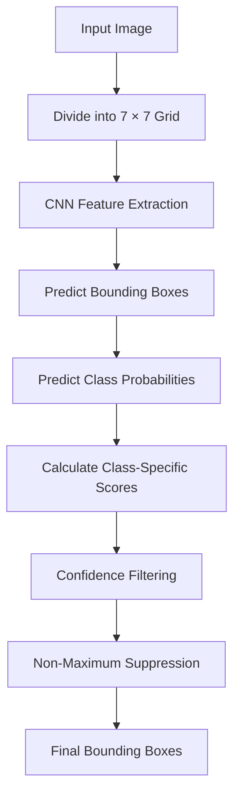

# YOLO Bounding Box — Interview Preparation

## 1. What Is a Bounding Box?

A **bounding box** is a rectangular box drawn around an object in an image to identify its location and size.

YOLO (You Only Look Once) uses bounding boxes to localize objects such as people, cars, dogs, bicycles, and other objects.

For each detection, the model produces:
- **Bounding box:** Where the object is located.
- **Class label:** What the object is.
- **Confidence score:** The predicted score associated with the detection.

### Example

Suppose an image contains a dog and a car.

YOLO predicts:
- A bounding box around the dog.
- A bounding box around the car.
- A class label and score for each detection.

---

## 2. Bounding Box Representation

In the original YOLOv1 model, a bounding box is represented by five values:

\[
(x,y,w,h,\text{confidence})
\]

| Parameter | Meaning |
|---|---|
| \(x\) | Horizontal center coordinate relative to the responsible grid cell |
| \(y\) | Vertical center coordinate relative to the responsible grid cell |
| \(w\) | Width relative to the entire image |
| \(h\) | Height relative to the entire image |
| Confidence | Object-presence probability multiplied by IoU in the training target |

### Understanding the coordinates

- **x:** Indicates the horizontal location of the box center.
- **y:** Indicates the vertical location of the box center.
- **w:** Indicates how wide the box is.
- **h:** Indicates how tall the box is.
- **Confidence:** Represents the predicted objectness and localization quality.

**Important:** In YOLOv1, the center coordinates \(x\) and \(y\) are relative to the responsible grid cell, while \(w\) and \(h\) are relative to the full image.

---

## 3. Bounding Box Diagram

```text
              Image
   +--------------------------------+
   |                                |
   |        x_min                   |
   |           +-------------+      |
   |           |             |      |
   |           |    Object   |      |
   |           |      •      |      |
   |           |    Center   |      |
   |           +-------------+      |
   |             x_max              |
   |                                |
   +--------------------------------+
```

The dot represents the center of the bounding box.

A common alternative representation uses the top-left and bottom-right corners:

\[
(x_{\min},y_{\min},x_{\max},y_{\max})
\]

These corner coordinates are often used when drawing boxes with computer vision libraries.

---

## 4. How Does YOLO Predict a Bounding Box?

The original YOLOv1 model divides an input image of size 448 × 448 into a 7 × 7 grid.

\[
\text{Grid cells}=7\times7=49
\]

Each grid cell is responsible for detecting objects whose centers lie within it.

### Prediction process

1. The image is passed through the CNN.
2. The CNN extracts visual features.
3. Each grid cell predicts two candidate bounding boxes.
4. Each box predicts its center, width, height, and confidence.
5. The cell also predicts conditional class probabilities.
6. Class-specific scores are calculated.
7. Post-processing removes weak and redundant detections.

### Bounding box flow diagram



---

## 5. Numerical Example: Bounding Box Coordinates

Suppose the input image is 448 × 448 pixels.

For a 7 × 7 grid:

\[
\text{Cell size}=\frac{448}{7}=64\text{ pixels}
\]

Suppose a grid cell is located at column 3, row 2, using zero-based indexing.

The predicted bounding box values are:

\[
x=0.5,\quad y=0.25,\quad w=0.2,\quad h=0.3
\]

### Step 1: Calculate the center coordinates

The horizontal center is:

\[
c_x=(3+0.5)\times64=224
\]

The vertical center is:

\[
c_y=(2+0.25)\times64=144
\]

Therefore, the center is:

\[
(c_x,c_y)=(224,144)
\]

### Step 2: Calculate width and height in pixels

\[
\text{Width}=0.2\times448=89.6
\]

\[
\text{Height}=0.3\times448=134.4
\]

### Step 3: Calculate corner coordinates

\[
x_{\min}=c_x-\frac{\text{Width}}{2}
\]

\[
x_{\min}=224-44.8=179.2
\]

\[
x_{\max}=224+44.8=268.8
\]

Similarly:

\[
y_{\min}=144-\frac{134.4}{2}=76.8
\]

\[
y_{\max}=144+\frac{134.4}{2}=211.2
\]

The final corner coordinates are:

\[
\boxed{(179.2,76.8,268.8,211.2)}
\]

These coordinates describe the predicted box in the resized image. In practice, they may need to be mapped back to the original image dimensions.

---

## 6. What Is a Ground-Truth Bounding Box?

A **ground-truth bounding box** is the correct object location provided in the labelled training dataset.

For example, a person manually annotates a dog in an image and draws a rectangle around it. That rectangle becomes the ground-truth box.

During training:
1. YOLO predicts a bounding box.
2. The prediction is compared with the ground-truth box.
3. Localization loss is calculated.
4. Backpropagation updates the model's weights.

The objective is to make predicted boxes more closely match the ground-truth boxes.

---

## 7. What Is IoU (Intersection over Union)?

IoU measures how much the predicted bounding box overlaps with the ground-truth bounding box.

\[
IoU=\frac{\text{Intersection Area}}{\text{Union Area}}
\]

Where:
- **Intersection area:** The area shared by both boxes.
- **Union area:** The total area covered by either box.

### Example

Suppose:

- Intersection area = 60
- Union area = 100

Then:

\[
IoU=\frac{60}{100}=0.60
\]

The overlap ratio is 60%.

### Interpretation

| IoU | Meaning |
|---|---|
| 0 | No overlap |
| 0.5 | 50% intersection-to-union ratio |
| 1 | Perfect overlap |

A higher IoU generally indicates better overlap between the predicted box and the ground-truth box.

IoU is used to evaluate localization quality and is important in YOLOv1 confidence targets and bounding box assignment.

---

## 8. Confidence Score of a Bounding Box

The original YOLOv1 model defines the confidence target as:

\[
\boxed{\text{Confidence}=P_r(\text{Object})\times IoU}
\]

Where:
- \(P_r(\text{Object})\) is the probability that an object is present.
- IoU measures overlap with the ground-truth box.

### Example

Suppose:

```text
Object probability = 0.90
IoU = 0.80
```

Then:

\[
\text{Confidence}=0.90\times0.80=0.72
\]

The confidence target is 0.72.

**Important:** During inference, the model predicts confidence directly. It cannot calculate IoU with a ground-truth box because the correct box is unknown.

---

## 9. Class-Specific Bounding Box Score

YOLOv1 predicts conditional class probabilities:

\[
P(\text{Class}_c\mid\text{Object})
\]

The class-specific score is:

\[
\text{Class Score}
=
P(\text{Class}_c\mid\text{Object})
\times\text{Confidence}
\]

### Example

Suppose:

```text
Dog class probability = 0.80
Box confidence = 0.72
```

Then:

\[
\text{Dog score}=0.80\times0.72=0.576
\]

The dog detection score is 0.576.

This score helps rank candidate boxes and filter weak detections.

---

## 10. Bounding Box Loss

During training, YOLO learns to predict boxes that match ground-truth locations.

The original YOLOv1 loss includes a localization component that compares predicted and ground-truth coordinates.

It considers:
- Horizontal center error.
- Vertical center error.
- Width error.
- Height error.

The original formulation uses squared errors for center coordinates and square-root-transformed width and height.

### Why use square roots for width and height?

They reduce the disproportionate effect of errors on large boxes, giving relatively more importance to errors involving smaller boxes.

The localization loss is one part of the overall YOLOv1 loss, which also includes object confidence, no-object confidence, and classification terms.

---

## 11. What Is Non-Maximum Suppression (NMS)?

YOLO can predict multiple overlapping boxes for the same object.

NMS reduces redundant detections by retaining high-scoring boxes and suppressing sufficiently overlapping lower-scoring boxes, generally within the same class.

### Example

Suppose YOLO predicts three boxes around one car:

| Bounding box | Score |
|---|---:|
| Box A | 0.95 |
| Box B | 0.82 |
| Box C | 0.65 |

NMS:
1. Selects Box A because it has the highest score.
2. Calculates overlap with the other boxes.
3. Suppresses sufficiently overlapping boxes of the same class.
4. Continues with remaining candidates.

The result is a cleaner set of detections with fewer duplicates.

### Confidence threshold vs NMS

- **Confidence thresholding:** Removes boxes with low detection scores.
- **NMS:** Removes redundant overlapping boxes.

NMS is a post-processing step, not a neural network layer in original YOLOv1.

---

## 12. Complete Bounding Box Detection Flow

```text
Input Image
     |
     v
CNN Feature Extraction
     |
     v
Grid-Based Predictions
     |
     v
Bounding Box Coordinates
(x, y, w, h, confidence)
     |
     v
Class Probability Prediction
     |
     v
Class-Specific Scores
     |
     v
Confidence Filtering
     |
     v
Non-Maximum Suppression
     |
     v
Final Bounding Box
+ Class Label
+ Detection Score
```

---

## 13. Common Interview Questions

### Q1. What is a bounding box?

A bounding box is a rectangle that identifies the location and size of an object in an image.

### Q2. What are the five YOLOv1 bounding box values?

The five values are x, y, width, height, and confidence.

### Q3. What is the difference between x and width?

The x coordinate indicates the horizontal center position relative to the responsible grid cell. Width indicates the box width relative to the entire image.

### Q4. What is a ground-truth box?

It is the correct bounding box supplied in the labelled training dataset.

### Q5. What is IoU?

IoU measures the overlap between a predicted box and a ground-truth box by dividing intersection area by union area.

### Q6. What does the YOLOv1 confidence score represent?

Its training target is object-presence probability multiplied by IoU.

### Q7. Why is bounding box loss needed?

It helps the model learn accurate object locations and sizes by penalizing differences between predicted and ground-truth coordinates.

### Q8. What is NMS?

Non-Maximum Suppression removes redundant overlapping detections while retaining stronger-scoring boxes.

### Q9. What is the difference between confidence filtering and NMS?

Confidence filtering removes weak detections, whereas NMS suppresses redundant overlapping detections.

### Q10. Why are bounding boxes important in YOLO?

They provide the spatial locations of detected objects, allowing the model to localize multiple objects in an image.

---

## 14. Quick Revision Table

| Concept | Key point |
|---|---|
| Bounding box | Rectangle locating an object |
| YOLOv1 box format | \(x,y,w,h,\text{confidence}\) |
| x and y | Center coordinates relative to grid cell |
| w and h | Dimensions relative to image |
| Ground truth | Correct annotated box |
| IoU | Intersection area divided by union area |
| Confidence target | Object probability × IoU |
| Localization loss | Penalizes box coordinate and size errors |
| Class-specific score | Conditional class probability × box confidence |
| Confidence filtering | Removes weak detections |
| NMS | Removes redundant overlapping detections |

## Final Takeaway

A bounding box identifies **where an object is located**, while the class label identifies **what the object is**.

Remember the sequence:

**Predict coordinates → Calculate confidence and class scores → Filter weak predictions → Apply NMS → Return final bounding boxes.**

These notes describe the original YOLOv1 bounding box representation. Modern YOLO versions may use different coordinate encodings, prediction heads, and loss functions.
