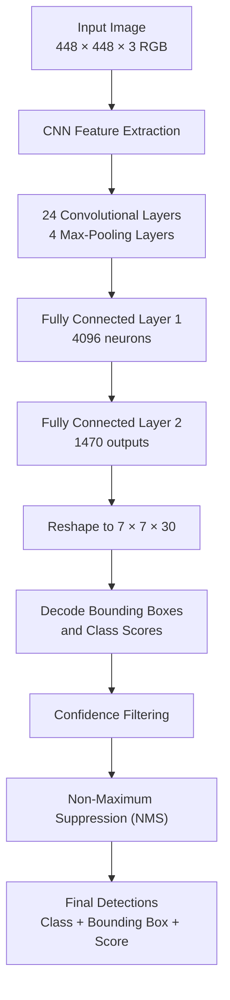

# YOLO Architecture — Interview Preparation

## 1. Introduction to YOLO

**YOLO stands for You Only Look Once.**

YOLO is a deep learning-based, single-stage object detection model that identifies objects and predicts their locations in an image in one forward pass through a neural network.

It predicts:
- **Class label:** What the object is, such as a person, car, or dog.
- **Bounding box:** Where the object is located.
- **Confidence score:** How strongly the model supports the detection.

### Why is YOLO important?

- Performs object detection in a single network pass.
- Predicts object locations and classes together.
- Supports real-time object detection.
- Processes multiple objects in the same image.
- Is used in traffic monitoring, robotics, surveillance, and industrial inspection.

> **Note:** These notes explain the original YOLOv1 architecture. Modern YOLO versions have different architectures and prediction mechanisms.

---

## 2. YOLO Architecture Flow Diagram



### Overall flow

**Input Image → CNN → Feature Extraction → Fully Connected Layers → Prediction Tensor → Post-processing → Final Detections**

---

## 3. Input Preprocessing

The original YOLOv1 model takes an input image of size:

`448 × 448 × 3`

Where:
- 448 = image height.
- 448 = image width.
- 3 = RGB color channels.

The image is resized to a fixed dimension and converted into a numerical tensor that the neural network can process.

### Why is preprocessing needed?

- Provides a consistent input size.
- Converts the image into a numerical representation.
- Makes the input suitable for CNN processing.

**Interview answer:** The first step is input preprocessing. The image is resized to 448 × 448 pixels and represented as a three-channel RGB tensor.

---

## 4. CNN Backbone

The original YOLOv1 architecture consists of:
- 24 convolutional layers.
- 4 max-pooling layers.
- 2 fully connected layers.

The CNN extracts hierarchical features from the image.

### How does feature extraction work?

1. Early layers detect edges, lines, and simple textures.
2. Intermediate layers learn shapes and patterns.
3. Deeper layers learn complex features, such as object parts.
4. These features are used to predict object locations and classes.

### Convolutional layers

YOLOv1 uses different convolution filter sizes, particularly 1 × 1 and 3 × 3 convolutions.

#### A. 1 × 1 convolution

A 1 × 1 convolution operates across the channels at each spatial position.

**Purpose:**
- Combines information across channels.
- Can reduce the number of channels.
- Helps reduce computational cost.

#### B. 3 × 3 convolution

A 3 × 3 convolution examines a local neighborhood of the feature map.

**Purpose:**
- Extracts spatial features.
- Learns edges, textures, shapes, and object parts.
- Helps the network recognize complex patterns.

### Example of channel reduction

Suppose the input feature map has 256 channels.

```text
Input Feature Map
56 × 56 × 256
       |
       v
1 × 1 Convolution
128 filters
       |
       v
56 × 56 × 128
       |
       v
3 × 3 Convolution
256 filters
       |
       v
Output Feature Map
56 × 56 × 256
```

The 1 × 1 convolution reduces the channel depth before the more computationally expensive 3 × 3 convolution.

This is an illustrative example of the concept, not the exact dimensions of every YOLOv1 layer.

### Layer progression in YOLOv1

| Stage | Main operation | Purpose |
|---|---|---|
| 1 | 7 × 7 convolution with 64 filters and stride 2 | Initial feature extraction and downsampling |
| 2 | Max pooling and 3 × 3 convolution | Extract richer features |
| 3 | Alternating 1 × 1 and 3 × 3 convolutions | Reduce channels and extract spatial features |
| 4 | Repeated convolutional blocks | Learn complex object features |
| 5 | Convolutions with up to 1024 filters | Extract high-level semantic features |
| 6 | Final convolutional layers | Prepare features for prediction |

### Max-pooling layers

Max pooling reduces the spatial dimensions of a feature map by selecting the maximum value within a local region.

Example:

```text
1  3
2  8

Max-pooling output = 8
```

**Purpose:**
- Reduces spatial dimensions.
- Reduces computation in subsequent layers.
- Retains strong activations within pooling regions.

Excessive downsampling can discard fine spatial details, making small objects harder to detect.

---

## 5. Fully Connected Layers

After convolutional feature extraction, YOLOv1 uses two fully connected layers.

### Fully connected layer 1

- Combines the features extracted by the CNN.
- Uses 4096 neurons in the original architecture.
- Applies dropout during training to reduce overfitting.

### Fully connected layer 2

- Produces 1470 raw prediction values.
- These values are reshaped into a 7 × 7 × 30 tensor.

```text
CNN Feature Maps
       |
       v
Flatten
       |
       v
Fully Connected Layer 1
4096 neurons
       |
       v
Fully Connected Layer 2
1470 outputs
       |
       v
Reshape
7 × 7 × 30
```

Unlike many modern detectors, original YOLOv1 does not use a separate modern-style feature pyramid neck.

---

## 6. YOLO Grid System

YOLOv1 divides the input image into a 7 × 7 grid.

```text
S = 7

Total grid cells = 7 × 7 = 49
```

Each grid cell is responsible for detecting an object whose center lies within that cell.

For example:
- The cell containing the center of a dog is responsible for predicting the dog.
- The cell containing the center of a car is responsible for predicting the car.

Each grid cell predicts:
- Two bounding boxes.
- Two box confidence scores.
- One set of 20 conditional class probabilities.

**Important:** Each cell has one class-probability vector shared by its two bounding box predictions.

---

## 7. Bounding Box Prediction

A bounding box is a rectangle around an object.

In YOLOv1, each bounding box contains five values:

`(x, y, w, h, confidence)`

| Parameter | Meaning |
|---|---|
| x | Horizontal center coordinate relative to the grid cell |
| y | Vertical center coordinate relative to the grid cell |
| w | Width relative to the image |
| h | Height relative to the image |
| Confidence | Object-presence probability multiplied by IoU in the training target |

### Example

Suppose a predicted box has:

```text
x = 0.5
y = 0.25
w = 0.2
h = 0.3
```

Interpretation:
- The center is halfway across the responsible grid cell.
- The center is one-quarter of the way down that cell.
- The box width is 20% of the image width.
- The box height is 30% of the image height.

The coordinates are converted into image pixel coordinates when the box is drawn.

### Confidence score

YOLOv1 defines the confidence target as:

\[
\text{Confidence}=P_r(\text{Object})\times IoU
\]

Where:
- \(P_r(\text{Object})\) = probability that an object is present.
- IoU = Intersection over Union.

During inference, the model predicts confidence directly; it does not know the ground-truth box.

---

## 8. Intersection over Union (IoU)

IoU measures the overlap between a predicted bounding box and a ground-truth bounding box.

\[
IoU=\frac{\text{Intersection Area}}{\text{Union Area}}
\]

Where:
- **Intersection:** Area shared by both boxes.
- **Union:** Total area covered by either box.

### Example

Suppose:

```text
Intersection area = 60
Union area = 100
```

Then:

\[
IoU=\frac{60}{100}=0.60
\]

An IoU of 0 indicates no overlap. An IoU of 1 indicates perfect overlap.

IoU is used to assess localization quality and plays an important role in YOLOv1 confidence targets and bounding box responsibility assignment.

---

## 9. Class Probability Prediction

In addition to bounding boxes, each grid cell predicts conditional class probabilities.

\[
P(\text{Class}_c\mid\text{Object})
\]

The original YOLOv1 PASCAL VOC model predicts probabilities for 20 object classes.

Example:

| Class | Probability |
|---|---:|
| Dog | 0.80 |
| Cat | 0.10 |
| Horse | 0.05 |
| Other classes combined | 0.05 |

These are illustrative values.

### Class-specific confidence score

The class-specific score is obtained by multiplying the conditional class probability by the box confidence.

\[
\text{Class Score}
=
P(\text{Class}_c\mid\text{Object})
\times \text{Confidence}
\]

For example:

```text
Dog class probability = 0.80
Box confidence = 0.72
```

\[
\text{Dog score}=0.80\times0.72=0.576
\]

The score is 0.576.

---

## 10. Why Is the Output Tensor 7 × 7 × 30?

This is one of the most important YOLOv1 interview questions.

The original model uses:

- \(S=7\): Grid size.
- \(B=2\): Bounding boxes per cell.
- \(C=20\): Object classes.
- 5 values per bounding box.

The number of values per grid cell is:

\[
B\times5+C
\]

Substituting:

\[
(2\times5)+20=30
\]

Therefore, the output tensor is:

\[
S\times S\times(5B+C)
\]

\[
7\times7\times30=1470
\]

### Breakdown of one grid cell

```text
Bounding Box 1 = 5 values
Bounding Box 2 = 5 values
Class Probabilities = 20 values

Total = 5 + 5 + 20 = 30
```

There are 49 grid cells.

```text
49 × 30 = 1470 values
```

**Interview point:** The 7 × 7 × 30 output applies to the original YOLOv1 model trained for 20 PASCAL VOC classes. Modern YOLO versions use different prediction formats.

---

## 11. Activation Functions

### Leaky ReLU

YOLOv1 uses Leaky ReLU in its hidden layers.

\[
f(x)=
\begin{cases}
x & x>0\\
0.01x & x\leq0
\end{cases}
\]

Examples:

```text
Input = 5
Output = 5

Input = -5
Output = -0.05
```

Leaky ReLU allows a small gradient for negative inputs, helping reduce the problem of inactive neurons.

### Linear activation

The final fully connected layer uses a linear activation to produce raw predictions.

\[
f(x)=x
\]

### Dropout and Batch Normalization

- **Dropout:** Used in original YOLOv1 after the first fully connected layer to reduce overfitting.
- **Batch Normalization:** Introduced as an improvement in YOLOv2; it was not a standard component of original YOLOv1.

---

## 12. YOLO Loss Function

The loss function measures the difference between predicted values and ground-truth values.

YOLOv1 uses a sum-squared-error objective combining localization, confidence, and classification errors.

### A. Localization loss

Measures errors in predicted bounding box coordinates.

It compares:
- Predicted x and y coordinates.
- Predicted width and height.

The original loss uses square roots of width and height to give relatively greater importance to errors involving small boxes.

### B. Object confidence loss

For the responsible bounding box, the model learns a confidence target based on object presence and IoU.

### C. No-object confidence loss

Penalizes confidence predictions from cells or boxes not responsible for an object.

A smaller weight prevents the many empty cells from dominating the loss.

### D. Classification loss

Measures errors in conditional class probabilities for cells responsible for objects.

### Overall loss structure

\[
\begin{aligned}
L={}&\lambda_{\text{coord}}L_{\text{localization}}\\
&+L_{\text{object confidence}}\\
&+\lambda_{\text{noobj}}L_{\text{no-object confidence}}\\
&+L_{\text{classification}}
\end{aligned}
\]

Where:
- \(\lambda_{\text{coord}}\) increases the importance of localization accuracy.
- \(\lambda_{\text{noobj}}\) reduces the contribution from empty cells.

The original paper uses:

\[
\lambda_{\text{coord}}=5
\]

\[
\lambda_{\text{noobj}}=0.5
\]

These terms help the model learn object locations, confidence, and classes together.

---

## 13. Training Process

The original YOLOv1 training approach uses two main stages.

### Stage 1: Pretraining

The convolutional network is pretrained on ImageNet classification data to learn general visual features.

### Stage 2: Object detection training

The model is adapted and trained for object detection using a detection dataset such as PASCAL VOC.

### Training flow

```text
Collect and Label Images
          |
          v
Preprocess Images
          |
          v
Forward Propagation
          |
          v
Predict Boxes and Classes
          |
          v
Calculate Loss
          |
          v
Backpropagation
          |
          v
Update Weights
          |
          v
Repeat Across Training Batches
```

The model gradually learns to predict more accurate bounding boxes and class probabilities.

---

## 14. Object Detection During Inference

Once training is complete, YOLO detects objects in new images.

### Step 1: Input image

Resize and preprocess the image according to the trained model's requirements.

### Step 2: Predict bounding boxes

The network predicts candidate boxes, confidence scores, and class probabilities.

### Step 3: Calculate class-specific scores

Multiply class probabilities by the corresponding box confidence.

### Step 4: Confidence filtering

Remove low-scoring predictions using a selected confidence threshold.

### Step 5: Non-Maximum Suppression (NMS)

Remove redundant overlapping detections.

### Step 6: Final output

Display the remaining bounding boxes, class labels, and scores.

### NMS example

Suppose the model predicts three boxes around one car:

| Box | Score |
|---|---:|
| A | 0.95 |
| B | 0.82 |
| C | 0.65 |

NMS selects the highest-scoring box and suppresses sufficiently overlapping lower-scoring boxes of the same class.

NMS is post-processing, not a neural network layer in the original YOLOv1 architecture.

---

## 15. Advantages of YOLO

1. **High speed:** Single-pass prediction supports real-time applications.
2. **End-to-end learning:** Localization and classification are learned together.
3. **Global context:** The model uses the whole image during prediction.
4. **Efficiency:** Avoids the region-proposal stage used by two-stage detectors.
5. **Multiple-object detection:** Can detect multiple objects in one image.
6. **Wide applications:** Suitable for traffic monitoring, robotics, and industrial inspection.

## 16. Limitations of YOLOv1

1. Small objects can be difficult to detect.
2. Closely grouped object centers within one grid cell can be difficult to handle.
3. Bounding box localization may be inaccurate.
4. Visually similar classes may be confused.
5. Smaller models may trade accuracy for speed.

Later YOLO versions introduced architectural and training improvements to address several of these limitations.

---

## 17. YOLO Versions

| Version | Main improvement or characteristic |
|---|---|
| YOLOv1 | Introduced unified, grid-based single-stage detection. |
| YOLOv2 | Improved detection and introduced anchor boxes and batch normalization. |
| YOLOv3 | Used a deeper backbone and multi-scale predictions. |
| YOLOv4 | Added practical architecture and training improvements. |
| YOLOv5 | Popular PyTorch-based implementation. |
| YOLOv8 | Introduced an anchor-free detection head and other architectural changes. |
| Newer YOLO families | Continue to evolve in architecture, efficiency, training, and supported tasks. |

The exact architecture depends on the particular version and implementation.

---

## 18. Complete Interview Answer

**Question: Explain the architecture of YOLO.**

YOLO stands for You Only Look Once. It is a single-stage object detection model that predicts object classes and bounding box locations in one forward pass.

The original YOLOv1 architecture takes a 448 × 448 RGB image as input. It passes the image through a CNN containing 24 convolutional layers and four max-pooling layers.

The convolutional layers extract hierarchical features. YOLO uses 1 × 1 convolutions for channel mixing and reduction, and 3 × 3 convolutions for spatial feature extraction.

After the CNN, two fully connected layers produce 1470 values. These values are reshaped into a 7 × 7 × 30 tensor.

The 7 × 7 represents the grid cells. Each cell predicts two bounding boxes, with five values per box, and 20 conditional class probabilities.

The model combines box confidence and class probabilities to calculate class-specific scores. It then filters low-scoring predictions and applies Non-Maximum Suppression to remove redundant overlapping boxes.

Finally, YOLO returns object labels, bounding boxes, and detection scores.

Its main advantage is its unified single-pass detection approach, which supports fast object detection.

---

## 19. Important Interview Questions

### Q1. Why is YOLO called a single-stage detector?

Because it predicts object locations and classes directly in one unified network pass instead of first generating region proposals and then classifying them.

### Q2. What is the purpose of a 1 × 1 convolution?

It combines information across channels and can reduce channel depth, lowering computation in subsequent layers.

### Q3. Why does YOLO use 3 × 3 convolutions?

They extract spatial features such as edges, textures, shapes, and object parts.

### Q4. What is the purpose of max pooling?

It reduces spatial dimensions and computation while retaining strong activations in local regions.

### Q5. Why is the output tensor 7 × 7 × 30?

Each cell predicts two boxes containing five values each, plus 20 class probabilities:

\[
7\times7\times[(2\times5)+20]=1470
\]

### Q6. What does IoU measure?

IoU measures the overlap between a predicted bounding box and a ground-truth bounding box.

### Q7. What is NMS?

Non-Maximum Suppression removes redundant overlapping detections, retaining stronger-scoring boxes.

### Q8. What are the limitations of YOLOv1?

It can struggle with small objects, multiple object centers within one grid cell, and precise localization.

### Q9. Is YOLOv1 the same as modern YOLO?

No. Modern YOLO versions use different backbones, prediction heads, output formats, and training methods.

---

## 20. Quick Revision

| Concept | Remember |
|---|---|
| Full form | You Only Look Once |
| Input size | 448 × 448 × 3 |
| Convolutional layers | 24 |
| Max-pooling layers | 4 |
| Fully connected layers | 2 |
| First fully connected layer | 4096 neurons |
| Grid size | 7 × 7 |
| Bounding boxes per cell | 2 |
| Classes | 20 for PASCAL VOC |
| Values per box | 5 |
| Output tensor | 7 × 7 × 30 |
| Total outputs | 1470 |
| Hidden activation | Leaky ReLU |
| Localization metric | IoU |
| Post-processing | Confidence filtering and NMS |
| Main advantage | Unified single-pass object detection |

### Final takeaway

To explain YOLO confidently in an interview, understand the complete flow:

**Input → CNN feature extraction → Fully connected layers → 7 × 7 × 30 output → Bounding box decoding → Confidence filtering → NMS → Final detections.**

The most important numerical concept is:

\[
\boxed{7\times7\times[(2\times5)+20]=1470}
\]

This represents the original YOLOv1 prediction structure, not every modern YOLO version.